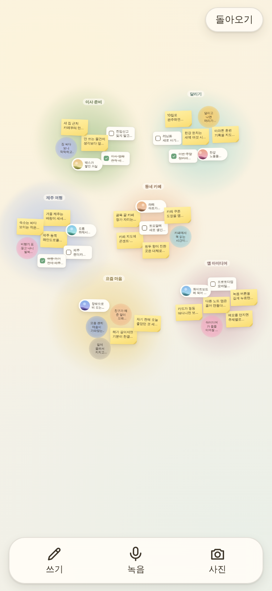

# 끄적임 노트

찰나의 생각·감정·사진을 아무렇게나 던지면, 앱이 메모의 특성을 파악해 **주제별로 분류**하고 **상관관계**를 분석해서 보드 위에 **주제 무리(cluster)**로 흩어진 듯 모여 있게 보여주는 모바일 우선 PWA입니다. 트리/폴더가 아니라 무리이고, 움직임(애니메이션)이 핵심입니다.

설계 문서: [docs/DESIGN.md](docs/DESIGN.md) (구현 중 달라진 점은 11장 "결정 기록")



## 실행

```bash
cd kkeujeogim
npm install
npm run dev          # http://localhost:5173  (/api/* 도 같은 서버에서 동작)
```

- `?demo=1` — 샘플 메모 40개(6개 주제)로 시작하는 데모 DB(`kkeujeogim-demo`). `?demo=1&reset=1`이면 데모 DB를 비우고 다시 채웁니다.
  데모 모드에서는 개발·e2e용으로 `window.__kk = { db, queue }`가 노출됩니다.
- 모바일에서 열면 홈 화면에 추가(PWA)할 수 있고, 오프라인에서도 열립니다.

### 스크립트

| 명령 | 내용 |
|---|---|
| `npm run typecheck` | `tsc --noEmit` (strict) |
| `npm run lint` | ESLint (`src/core` 경계 규칙 포함) |
| `npm test` | vitest 단위 테스트 (fake-indexeddb) |
| `npm run build` | 타입 검사 + 프로덕션 빌드(+ 서비스 워커) |
| `npm run test:e2e` | Playwright 스모크(375×812, 모바일) + `docs/screenshots/` 갱신 |

이 환경처럼 Chromium이 `/opt/pw-browsers`에 미리 설치되어 있으면 `playwright.config.ts`가 그 실행 파일을 씁니다
(`PW_CHROMIUM=/경로`로 바꿀 수 있어요). `npx playwright install`은 필요 없습니다.

## 정돈 방식: AI 없이도, 있으면 더 똑똑하게

앱은 시작할 때 `GET /api/health`를 불러 `{ "ai": true }`이면 **RemoteAnalyzer**(서버 프록시 → Claude), 아니면 **LocalAnalyzer**(키 없이 동작하는 한국어 규칙 + 키워드 유사도)를 자동으로 고릅니다. 설정 화면은 없습니다.

AI를 쓰려면 **서버 환경변수**로만 키를 넣습니다. 클라이언트 번들에는 들어가지 않습니다.

```bash
export ANTHROPIC_API_KEY=sk-ant-...   # 또는 kkeujeogim/.env.local 에 ANTHROPIC_API_KEY=...
npm run dev                            # /api/health → {"ai":true}
```

- 서버 핸들러: `server/organize.ts` (`@anthropic-ai/sdk`, 모델 `claude-haiku-5-5`, 도구 호출로 구조화 출력 강제, 사진은 이미지 블록). 프롬프트·도구 스키마는 `server/prompt.ts`.
- 개발/미리보기 서버(`npm run dev`, `npm run preview`)는 Vite 플러그인(`server/devMiddleware.ts`)이 `/api/*`를 같은 핸들러에 연결합니다.
- 모델 응답은 `src/core/organize/validate.ts`에서 다시 검증합니다(없는 id·범위 밖 값은 버리고, 주제가 엉망이면 정돈 실패 → 재시도 3번까지 지수 백오프).

## 구조

```
docs/                 DESIGN.md, screenshots/
server/               organize.ts(핸들러), prompt.ts, devMiddleware.ts
functions/            Firebase Functions(2세대) 래퍼 — 배포 연결은 2차 작업
src/core/             순수 TypeScript(React·DOM·Dexie 없음): 타입, Repo 인터페이스,
                      organize/(분석기·검증·반영·대기열·재구성), layout/(d3-force)
src/db/               Dexie 스키마(v2), DexieRepo(Repo 구현), 데모 시드
src/organize/         브라우저 어댑터: RemoteAnalyzer(fetch), 사진 base64, 대기열 조립
src/motion/           spring 프리셋, 포물선 키프레임, 보드↔대기열 이벤트 통로
src/ui/               Board, MemoCard(종류별), InputBar, PendingTray, MemoSheet, ClusterBar …
tests/unit, tests/e2e
```

`src/core`는 ESLint `no-restricted-imports`/`no-restricted-globals`로 react·dexie·framer-motion·브라우저 전역을 쓰지 못하게 막아 두었습니다. 저장소는 `Repo` 인터페이스로 주입하므로, 나중에 React Native로 옮길 때 core를 그대로 재사용할 수 있습니다(설계 8.1).

## 동작 요약

- **입력**: 쓰기(Enter 저장, Shift+Enter 줄바꿈) · 녹음(길게 누르는 동안 Web Speech `ko-KR`) · 사진(긴 변 1600px JPEG). 저장할 때 아무것도 묻지 않고 즉시 `pending`으로 저장합니다.
- **정돈**: 대기열이 오래된 순으로 하나씩 → 특성(종류·감정·키워드·요약) → 주제 배정 → 관련 메모 링크. 한 트랜잭션으로 반영합니다.
- **주제 재구성**: 주제에 메모가 5개 들어오면(10분에 한 번) 무리의 중심을 다시 잡아 이름을 바꾸고 안 맞는 메모를 옮깁니다. 직접 정한 메모/이름은 건드리지 않고, 한 번에 40% 넘게 빼지 않으며, 알림의 "되돌리기"로 복원됩니다.
- **보드**: 두 손가락 확대/이동(휠·드래그), 카드를 누르고 있으면 관련 메모가 빛나고 가는 곡선으로 이어집니다. 길게 눌러 들어 올려 다른 무리에 놓으면 주제 이동(고정), 빈 곳에 놓으면 새 주제. 무리를 탭하면 펼쳐지고 이름을 고칠 수 있습니다.
- **움직임**: `prefers-reduced-motion`이면 떠다니기·출렁임·포물선 비행을 끄고 위치 변경은 즉시(또는 페이드)로 바꿉니다.

## 배포 메모 (2차)

`functions/index.ts`는 `server/organize.ts`를 감싼 Cloud Functions(2세대, Node 22) 예시입니다. 루트의 기존 `firebase.json`은 건드리지 않았으므로 다음은 직접 연결해야 합니다.

1. `ANTHROPIC_API_KEY`를 Functions 비밀로 등록 (`firebase functions:secrets:set ANTHROPIC_API_KEY`).
2. `functions/`가 `../server`와 `../src/core`를 import하므로 배포 전에 빌드 산출물에 함께 담기(`tsconfig.json`의 `rootDir: ".."` 참고).
3. 호스팅 rewrite로 `/api/**` → 함수 연결, 정적 파일은 `npm run build`의 `dist/`.

로그인·동기화, 충돌 카드, 관점 렌즈, 알림은 v1 범위 밖입니다.
